# Kadro · Yapay Zekâ Destekli İşe Alım Platformu

[](https://github.com/mustafagulturk/ise-alim/actions/workflows/ci.yml)

Şirketlerin ilan açıp başvuru topladığı, gelen CV'leri yapay zekâyla ilana göre puanladığı ve adayları sürükle-bırak bir aday hattında mülakattan teklife kadar yönettiği bir işe alım (ATS) uygulaması. Adaylar şirketin kariyer sayfasından başvurur ve başvurularını kendilerine verilen bağlantıdan takip eder.

Backend **NestJS + PostgreSQL + Redis (BullMQ)**, arayüz **Next.js 15 + React 19** ile yazıldı. CV değerlendirmesi **Claude API** ile yapılır; API anahtarı yoksa kural tabanlı yerel puanlayıcı devreye girer, yani proje anahtarsız da tam çalışır.


> Videonun yüksek çözünürlüklü hâli: [docs/demo.mp4](docs/demo.mp4)

## Neler yapılabiliyor?

**Yapay zekâ ile CV değerlendirme**
- İlanın her gereksinimi için CV'den kanıt cümlesi bulunur ve "karşılıyor / kısmen / eksik" kararı verilir
- Puan modelin uydurduğu bir sayı değildir: gereksinim ağırlıklarına göre **sunucuda hesaplanır** (karşılıyor 1, kısmen 0,5, eksik 0). Zorunlu bir gereksinim eksikse puan en fazla 35 olur
- **KVKK**: CV yapay zekâya gitmeden önce ad, e-posta, telefon, bağlantılar ve doğum tarihi maskelenir
- Claude çağrısı yapılandırılmış çıktı (zod şeması), uyarlanabilir düşünme ve ilan bloğunda istem önbelleği kullanır; reddetme ve yarım kalan yanıtlar ayrıca ele alınır
- Anahtar yoksa ya da Claude hata verirse **yerel puanlayıcı** çalışır: Türkçe karakter normalizasyonu, eş anlamlılar sözlüğü, kök eşleştirme ve tarih aralıklarından deneyim yılı çıkarma
- İlan açarken açıklamadan gereksinim önerisi, gereksinimler değişince tüm adayları yeniden puanlama

**Aday hattı (kanban)**
- Yeni başvuru → Ön değerlendirme → Mülakat → Teklif → İşe alındı / Elendi
- Kartları sürükleyerek aşama değiştirme (iyimser güncelleme, hata olursa geri alınır), toplu taşıma ve toplu ret
- Puan ve beceri filtresi, sütun bazında ortalama puan, "zorunlu eksik" uyarısı
- 2-4 adayı gereksinim gereksinim **yan yana karşılaştırma**
- **Kör değerlendirme modu**: ön yargıyı azaltmak için isimler takma adla gösterilir

**Mülakat ve değerlendirme**
- Mülakat planlama, panel üyeleri, takvime eklemek için `.ics` dosyası
- Dört kriterli değerlendirme formu ve öneri (Kesinlikle hayır → Kesinlikle evet)
- Bir mülakatçı, **kendi formunu göndermeden diğerlerinin puanını göremez** (sunucuda zorlanır, arayüzde gizlemekle kalmaz)

**Mülakat kiti**
- Her mülakat için adaya özel soru seti: CV analizinde eksik ya da kısmen karşılanan gereksinimler önce sorulur, karşılananlar CV'deki cümle alıntılanarak doğrulanır
- Her soruda "neden soruyoruz", iyi cevap işaretleri, dikkat edilecekler ve takip sorusu; soru sayısı mülakat süresine göre ayarlanır
- Önceki mülakatlardaki notlar yeni kitte dikkate alınır; kültür/İK mülakatlarında davranışsal sorular ağırlık kazanır
- Kit önce yerel üreticiyle anında hazırlanır, Claude varsa arka planda zenginleştirilir; değerlendirme formunda soru bazında not ve 👍/👎 tutulur

**Aday kendi mülakat saatini seçer**
- Mülakatçıların takviminden ortak boş saatler hesaplanır: hafta içi 09:00-18:00, öğle arası, mülakatlar arası 15 dk boşluk ve en az 12 saat önceden bildirim kuralı
- İK önerilen saatleri tek tıkla seçip gönderir, aday takip sayfasından birini onaylar; mülakat, panel, kit ve onay e-postası otomatik oluşur
- İki aday aynı anda aynı saati seçerse **Serializable işlemle** yalnızca biri kazanır, diğerine "saat doldu" denir; başka adaya gönderilmiş bekleyen saatler yeni önerilerde dolu sayılır

**Yetenek havuzu**
- Aday başvururken isteğe bağlı olarak diğer pozisyonlar için değerlendirilmeye onay verir (KVKK açık rıza), takip sayfasından geri çekebilir
- Yeni bir ilanda onay vermiş eski adaylar bu ilanın gereksinimlerine göre puanlanır; mülakata kadar gelip elenen "ikinci tercih" adaylar üstte gösterilir
- "Hatta ekle" ile CV kopyalanır, yeni başvuru açılır ve yeniden analiz edilir; aday profilinde diğer açık ilanlara uygunluğu görünür

**Canlı çalışma**
- Yeni başvuru geldiğinde, CV puanlandığında ya da bir aday taşındığında ekiptekilerin ekranı anında tazelenir ve bildirim düşer
- Redis pub/sub → Socket.IO; birden fazla API kopyası çalışsa da olaylar herkese ulaşır

**CV içinde arama**
- PostgreSQL tam metin araması (Türkçe kök bulma, GIN indeksi), sonuçta eşleşen cümle vurgulanır
- Vurgular HTML olarak basılmaz, React bileşeniyle işaretlenir (XSS'e kapalı)

**Aday tarafı**
- Sunucuda oluşturulan kariyer sayfaları, Google için `JobPosting` yapılandırılmış verisi
- PDF/DOCX başvuru (dosya imzasıyla tür kontrolü), KVKK onayı, hız sınırı
- Başvuru takip sayfası: hangi aşamada olduğu, kendisine giden e-postalar, başvuruyu geri çekme

**E-posta**
- Başvuru alındı, mülakat daveti, teklif ve ret şablonları; göndermeden önizleme
- Outbox deseni: e-posta önce kaydedilir, kuyruktan gönderilir, başarısız olursa yeniden denenir

**Analitik**
- Aşama dönüşüm hunisi (adayın ulaştığı en ileri aşamaya göre), kaynak dağılımı, puan dağılımı, ilk yanıt ve işe alım süresi, günlük başvuru grafiği

**Ekip ve güvenlik**
- Çok kiracılı yapı: her sorgu şirkete göre filtrelenir, bir şirket diğerinin verisini göremez (testle doğrulanır)
- Üç rol: **Yönetici**, **İK uzmanı**, **Mülakatçı**
- 15 dakikalık erişim token'ı + httpOnly çerezde dönen yenileme token'ı; çalınan token tekrar kullanılırsa tüm oturum ailesi iptal edilir

**Arayüz**
- Açık/koyu tema, mobil uyumlu, iskelet yükleme ekranları, sırayla beliren listeler, animasyonlu puan halkaları

## Ekran görüntüleri

| | |
|---|---|
| 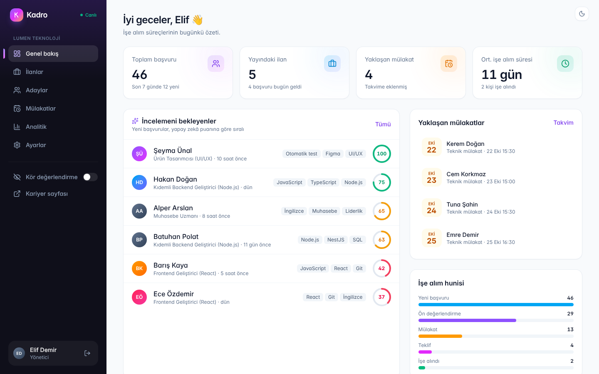 Genel bakış | 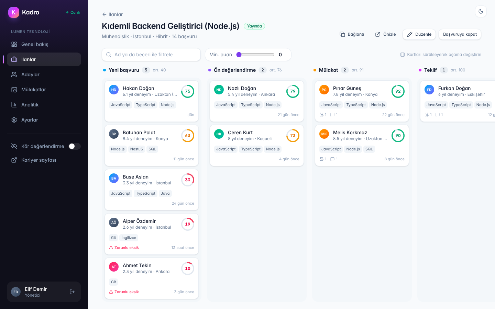 Aday hattı |
| 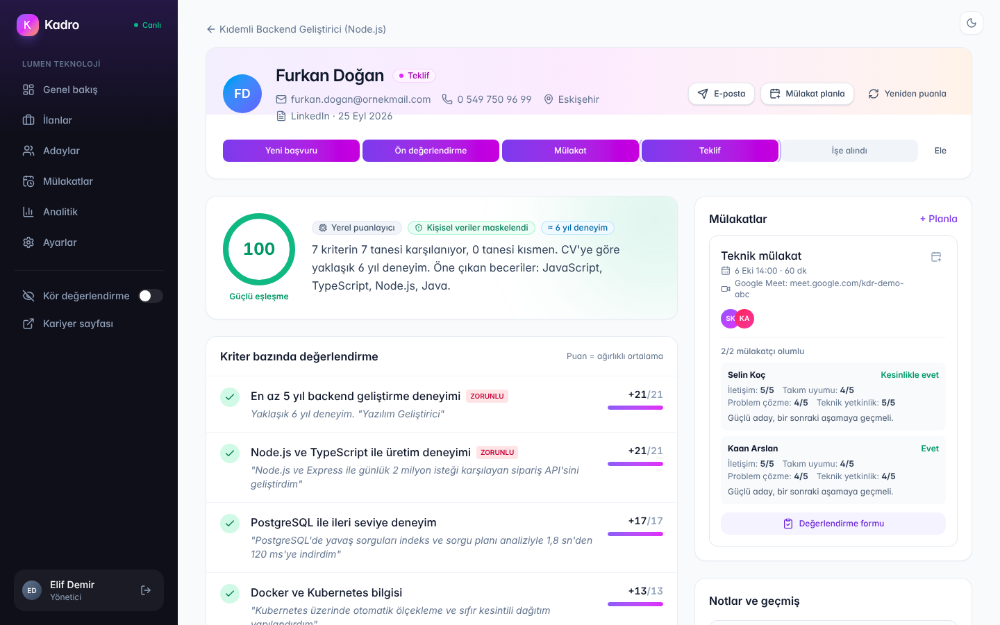 Gereksinim bazında CV analizi | 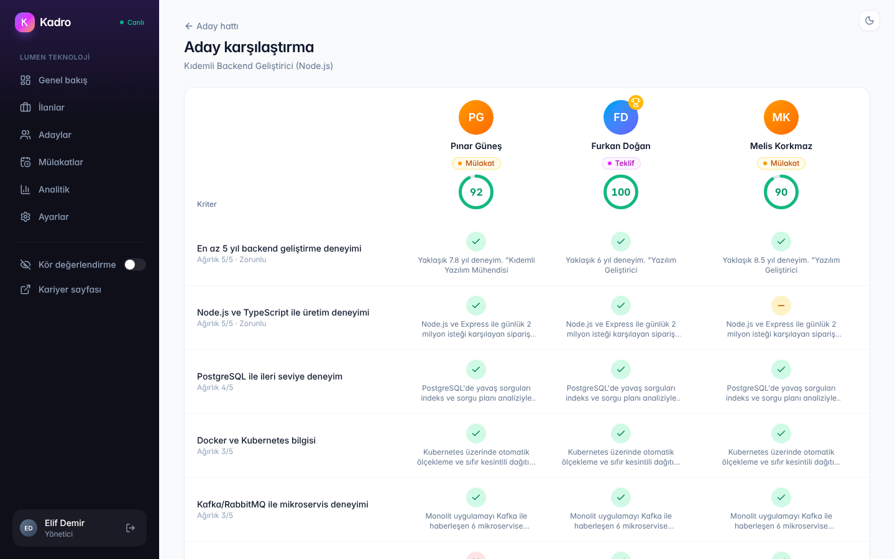 Aday karşılaştırma |
| 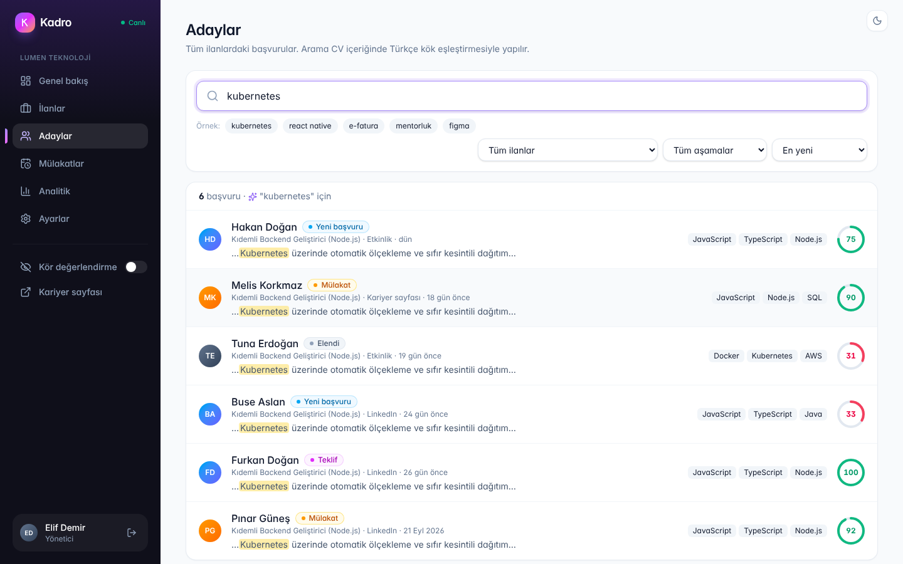 CV içinde tam metin arama | 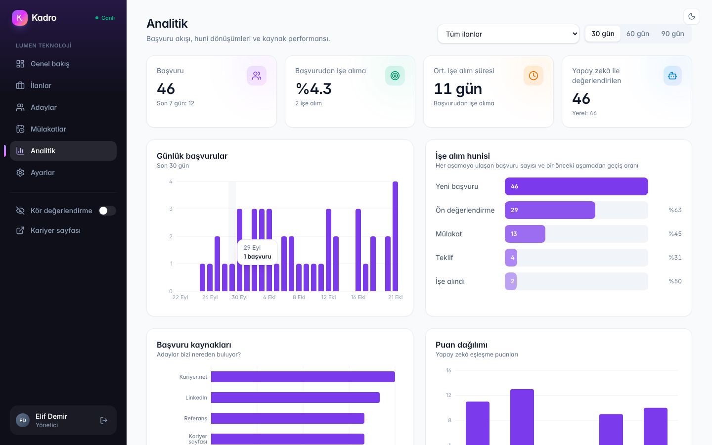 Analitik |
| 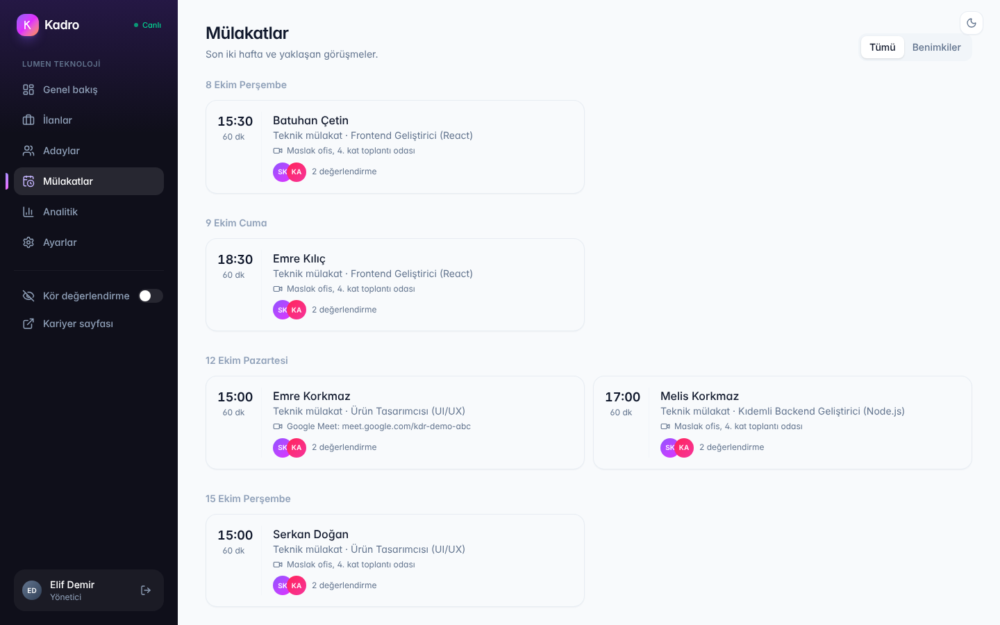 Mülakatlar | 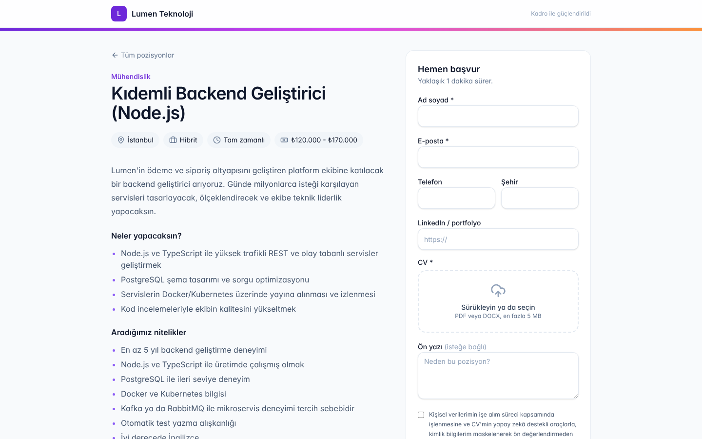 Kariyer sayfası |
| 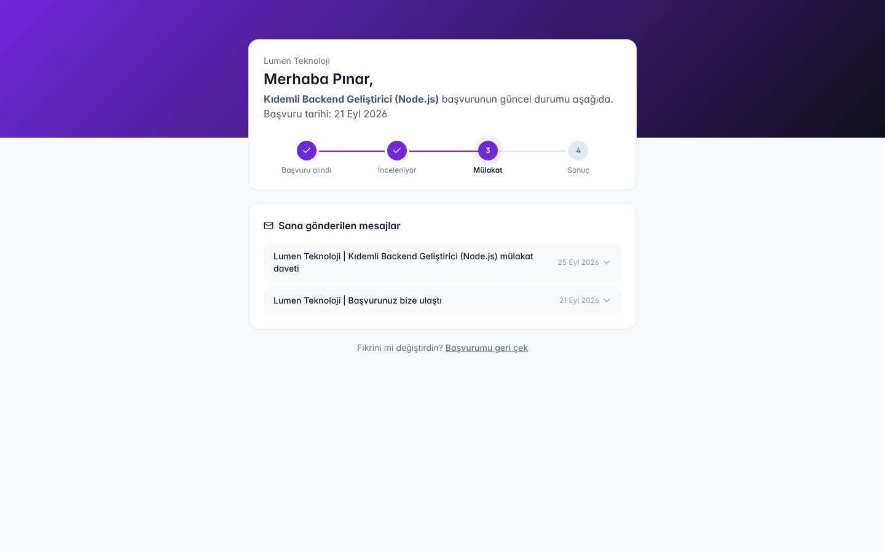 Aday başvuru takibi | 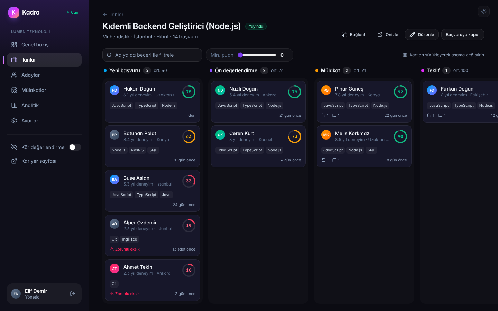 Koyu tema |
| 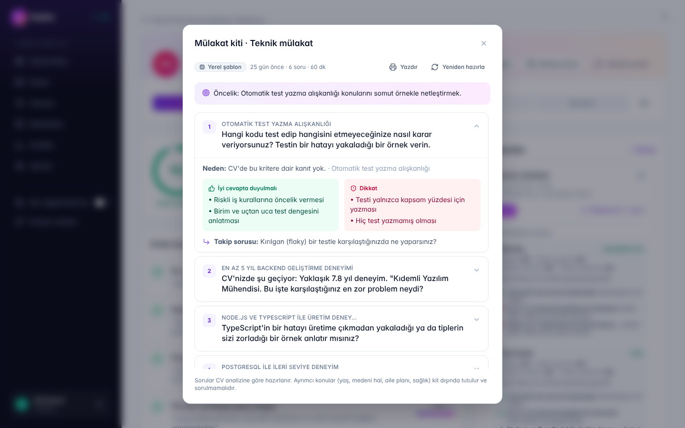 Adaya özel mülakat kiti | 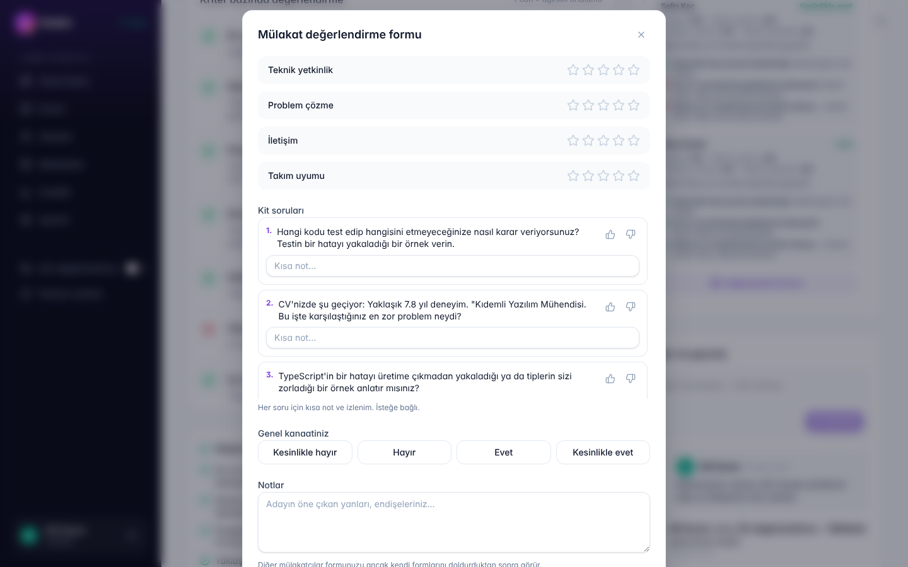 Soru bazında değerlendirme |
| 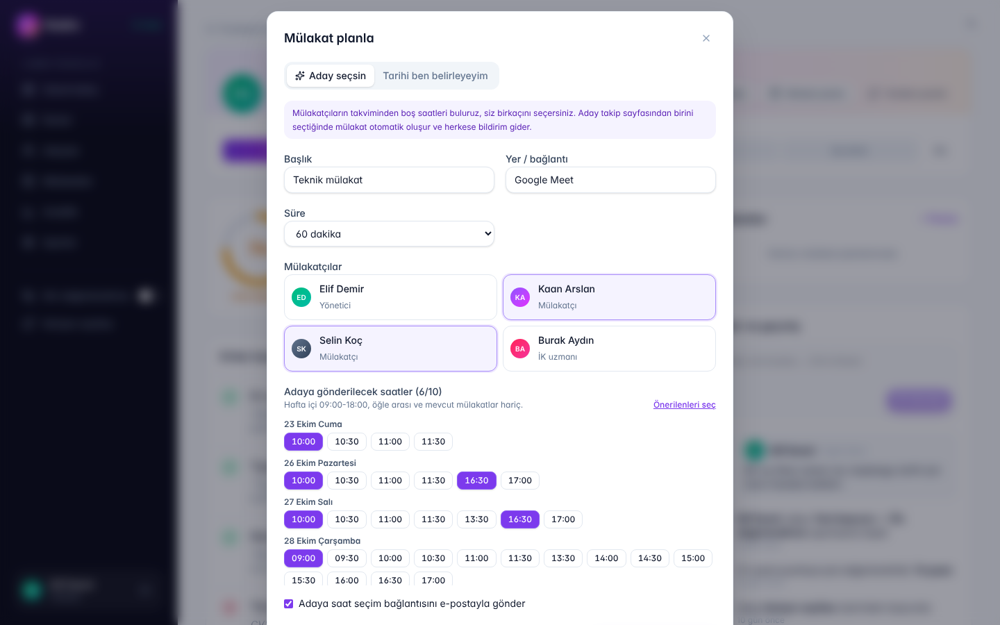 Mülakatçıların boş saatleri | 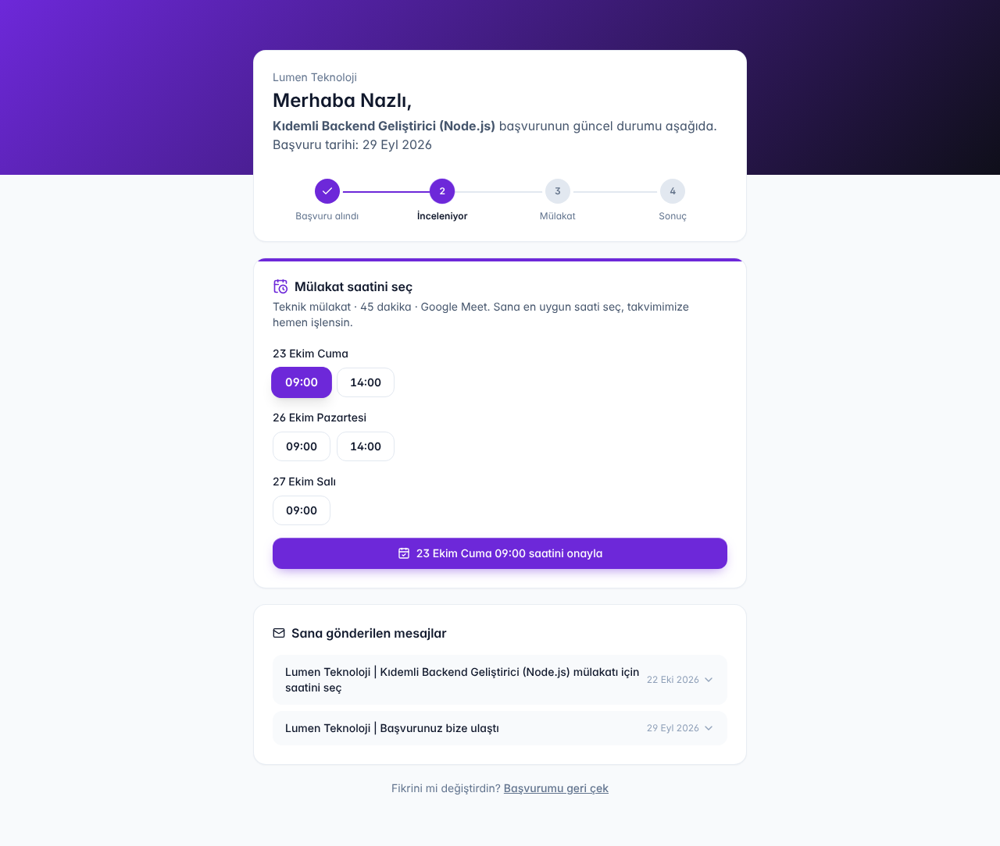 Adayın saat seçmesi |
| 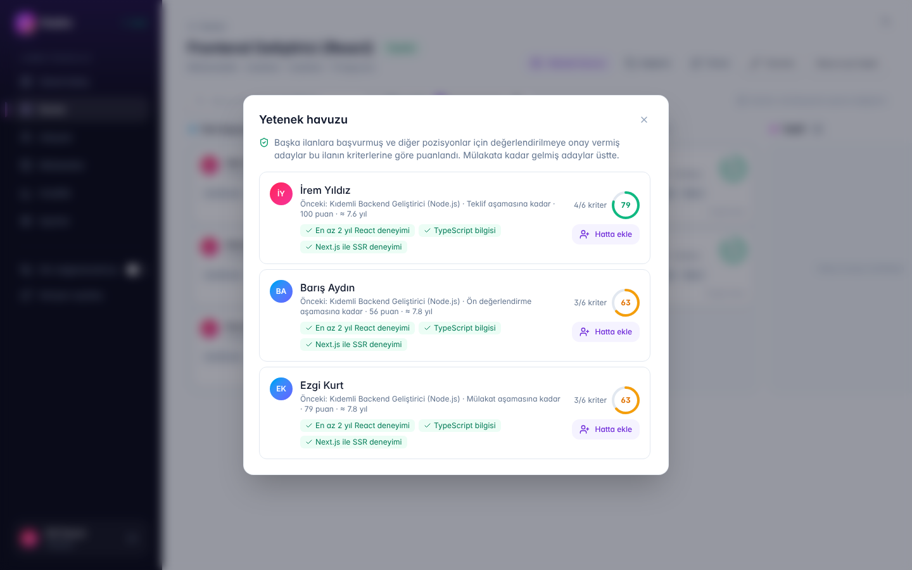 Yetenek havuzu | |

<p align="center">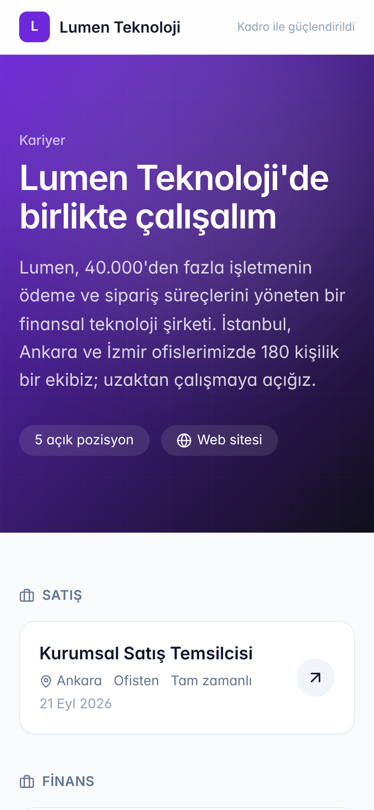</p>

## Mimari

```
                        ┌──────────────────────────┐
  Aday / İK  ──────────▶│  Next.js 15 (apps/web)   │  SSR kariyer sayfaları,
                        │  /api/* → API'ye yönlenir│  panel (React Query)
                        └────────────┬─────────────┘
                                     │ REST + Socket.IO
                        ┌────────────▼─────────────┐        ┌──────────────┐
                        │   NestJS API (apps/api)  │──────▶ │ PostgreSQL 16│
                        │  auth · ilan · başvuru   │ Prisma │  tsvector +  │
                        │  mülakat · analitik      │        │  GIN indeksi │
                        └───┬──────────────▲───────┘        └──────▲───────┘
              iş ekler      │              │ olay (pub/sub)        │
                        ┌───▼──────────────┴───────┐               │
                        │          Redis           │               │
                        └───┬──────────────────────┘               │
                            │ BullMQ                               │
                        ┌───▼──────────────────────┐               │
                        │   Worker (dist/worker)   │───────────────┘
                        │  cv-analysis · email     │
                        └───┬──────────────────────┘
                            │ anonimleştirilmiş CV
                        ┌───▼──────────────────────┐
                        │  Claude API  /  yerel    │
                        │  kural tabanlı puanlayıcı│
                        └──────────────────────────┘
```

Bir başvurunun yolculuğu:

1. Aday kariyer sayfasından PDF yükler. API dosya imzasını kontrol eder, CV metnini çıkarır, başvuruyu kaydeder ve `cv-analysis` kuyruğuna iş ekler. "Başvuru alındı" e-postası outbox'a yazılır.
2. Worker CV'yi kişisel verilerden arındırır, ilan gereksinimleriyle birlikte Claude'a gönderir (ya da yerel puanlayıcıyı çalıştırır) ve puanı hesaplar.
3. Sonuç kaydedilir, Redis'e olay yayınlanır, API bunu Socket.IO ile şirketin odasına iletir. Panelde "CV değerlendirildi: 89 puan" bildirimi çıkar, kanban tazelenir.

## Puan nasıl hesaplanıyor?

```
puan = Σ (ağırlık × karar) / Σ ağırlık × 100        karar: karşılıyor 1 · kısmen 0,5 · eksik 0
zorunlu bir gereksinim "eksik" ise  →  puan = min(puan, 35)
```

Modelden yalnızca her gereksinim için karar ve CV'den alıntılanan kanıt istenir. Toplama kodda yapıldığı için aynı kararlar her zaman aynı puanı verir ve İK, puanın nereden geldiğini satır satır görebilir. Kodu: [`apps/api/src/ai`](apps/api/src/ai).

## Teknolojiler

| Katman | Kullanılanlar |
|---|---|
| API | NestJS 11, Prisma 6, PostgreSQL 16, Redis 7, BullMQ, Socket.IO, zod, JWT, Throttler |
| Yapay zekâ | Anthropic SDK (Claude), yapılandırılmış çıktı, istem önbelleği, yerel yedek puanlayıcı |
| Web | Next.js 15 (App Router), React 19, TypeScript, Tailwind CSS 4, TanStack Query, dnd-kit, Recharts |
| Test / DevOps | Jest + Supertest (birim ve uçtan uca), GitHub Actions, Docker Compose |

## Kurulum

### Docker ile (en kolay yol)

```bash
docker compose up --build
```

- Arayüz: http://localhost:3000
- API: http://localhost:4000/api/health

Açılışta veritabanı şeması kurulur ve demo verisi yüklenir. Claude ile puanlamak için anahtarı vererek başlatın: `ANTHROPIC_API_KEY=sk-ant-... docker compose up --build`

### Yerel geliştirme

Gerekenler: Node.js 22, PostgreSQL 16, Redis 7.

```bash
npm install
cp apps/api/.env.example apps/api/.env
cp apps/web/.env.example apps/web/.env.local
createdb kadro
npm run db:setup     # şema + demo verisi
npm run dev          # API :4000, worker ve web :3000
```

### Demo hesapları

Hepsinin şifresi `Demo1234!`. Giriş ekranındaki butonlarla tek tıkla da girilebilir.

| E-posta | Rol |
|---|---|
| demo@kadro.dev | Yönetici |
| ik@kadro.dev | İK uzmanı |
| mulakat@kadro.dev | Mülakatçı |

Demo verisinde 6 ilan, 46 aday, gerçek PDF CV'ler, mülakatlar, değerlendirme formları ve e-postalar bulunur. Kariyer sayfası: http://localhost:3000/kariyer/lumen

## API'ye genel bakış

Tüm uçlar `/api` altındadır.

| Alan | Uçlar |
|---|---|
| Kimlik | `POST auth/register` `auth/login` `auth/refresh` `auth/logout` · `GET auth/me` |
| İlanlar | `GET/POST jobs` · `GET/PUT/DELETE jobs/:id` · `PATCH jobs/:id/status` · `POST jobs/:id/rescore` · `POST jobs/suggest-requirements` |
| Başvurular | `GET jobs/:jobId/applications` · `GET applications?q=` · `GET applications/compare` · `GET applications/:id` · `GET applications/:id/cv` · `PATCH applications/:id/move` · `POST applications/bulk` · `POST applications/:id/notes` · `POST applications/:id/rescore` · `POST applications/:id/emails` |
| Mülakatlar | `GET interviews` · `POST applications/:id/interviews` · `PUT interviews/:id/scorecard` · `PATCH interviews/:id/cancel` · `GET interviews/:id/ics` · `POST interviews/:id/kit` · `GET applications/:id/invite-slots` · `POST applications/:id/invites` · `PATCH invites/:id/cancel` |
| Yetenek havuzu | `GET jobs/:id/talent-pool` · `POST jobs/:id/talent-pool/:candidateId` · `GET applications/:id/matches` |
| Kariyer (herkese açık) | `GET careers/:slug` · `GET careers/:slug/jobs/:jobSlug` · `POST careers/:slug/jobs/:jobSlug/apply` · `GET track/:token` · `POST track/:token/withdraw` · `POST track/:token/book` · `GET track/:token/interviews/:id/ics` · `POST track/:token/leave-pool` |
| Şirket | `GET/PATCH company` · `GET/POST company/members` · `GET company/emails` · `GET analytics` |

## Testler

```bash
createdb kadro_test
npm test
```

40 test: puan hesabı, KVKK maskeleme, deneyim yılı çıkarma, Türkçe eşleştirme, mülakat kiti ve boş saat hesabı için birim testleri; kayıt ve giriş, yenileme token'ının tekrar kullanımı, şirketler arası veri izolasyonu, mülakatçı yetkileri, başvuru, aşama değiştirme, tam metin arama, adayın saat seçmesi (aynı saate ikinci rezervasyonun reddi dahil) ve yetenek havuzu için uçtan uca testler. GitHub Actions her push'ta PostgreSQL ve Redis ile testleri, tip kontrolünü ve derlemeyi çalıştırır.

## Proje yapısı

```
apps/
  api/          NestJS API ve worker
    prisma/     şema, migration, demo verisi (PDF CV üretimi dahil)
    src/ai/     anonimleştirme, Claude ve yerel puanlayıcı, puan hesabı
    test/       birim ve uçtan uca testler
  web/          Next.js arayüzü (panel + kariyer sayfaları)
docs/           ekran görüntüleri ve demo video
```

---

Mustafa Gültürk · [mustafagulturk.github.io](https://mustafagulturk.github.io)
